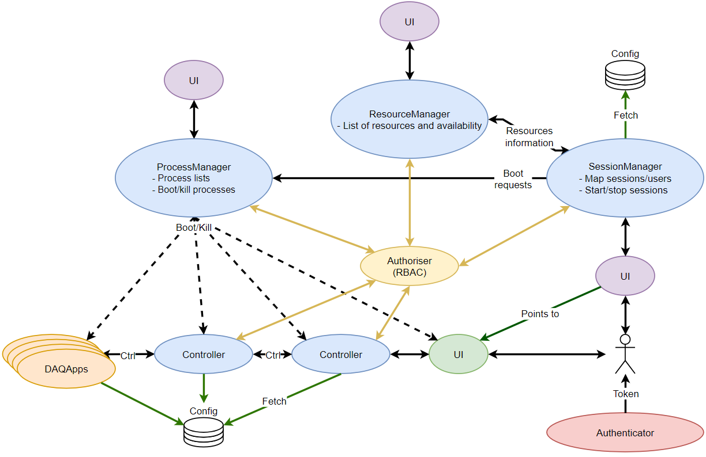

# DUNE Run Control (drunc)

[Develop test coverage report](https://dune-daq.github.io/drunc/coverage/develop/)

Users - see the [documentation](https://dune-daq.github.io/drunc/)

This software defines a flexible run control infrastructure for a distributed DAQ system defined in a set of configuration files used at run time for DUNE. Operation of the experiment is defined through a finite state machine (FSM) which describes the operational state of the DAQ.

The project is still under development, and as such will still have bugs or features that users may not want. If you encounter any of these please raise an issue and describe it clearly so that we can resolve it easily.

# Setting up
If you are trying to run `drunc` you **must** have a DUNE-DAQ environment, with `cvmfs` available. See setup instructions [here](https://dune-daq-sw.readthedocs.io/en/latest/packages/daq-buildtools/) to setup an nightly or a static release.

# Running drunc
Once you have drunc, you can look at the [quick start instructions](https://dune-daq-sw.readthedocs.io/en/latest/packages/drunc/Running-drunc).

If you need more details:
* [Process manager](https://dune-daq-sw.readthedocs.io/en/latest/packages/drunc/Process-manager)
* [Controller](https://dune-daq-sw.readthedocs.io/en/latest/packages/drunc/Controller)
* [Unified shell](https://dune-daq-sw.readthedocs.io/en/latest/packages/drunc/Unified-shell-reference) (merges the controller and process manager shells)

There are more in depth descriptions of part of the system here:
* [FSM](https://dune-daq-sw.readthedocs.io/en/latest/packages/drunc/FSM)

Finally, we have a [FAQ](https://dune-daq-sw.readthedocs.io/en/latest/packages/drunc/FAQ), have a look there if you have a problem!

# Developing
If are developing a user interface for `drunc`, you can get help here:
* [Messaging format](https://dune-daq-sw.readthedocs.io/en/latest/packages/drunc/Messaging-format) (valid for all the `drunc` endpoints)
* [Process manager endpoint description](https://dune-daq-sw.readthedocs.io/en/latest/packages/drunc/Process-manager-interface)
* [Controller endpoint description](https://dune-daq-sw.readthedocs.io/en/latest/packages/drunc/Controller-interface)
* [Graph](graph/) (interactive UML class/package diagrams)

There is more developer information in the [drunc wiki](https://github.com/DUNE-DAQ/drunc/wiki).

## Pull request workflow

1. New or reopened PRs are automatically converted to draft. Complete the developer checklist before marking the PR **Ready for review**.
2. Changed files determine the PR labels. When the PR is ready, the workflow requests all matching reviewers except the author and posts a review tracker with a reviewer checklist.
3. Reviewers tick the checklist in the bot's tracker comment. Once complete, post `/checklist-complete` in a new PR comment to rerun the checklist check. Existing review requests and checklist ticks are preserved on routing reruns.
   The workflow acknowledges the command with an eyes reaction, then adds thumbs up if the retry script exits successfully (including skipped retries), or thumbs down if it fails. These reactions report the retry script's outcome, not the rerun checklist's result.
4. An approval triggers a one-time comment with the final steps to follow before merging.

# Release notes
... are [here](https://dune-daq-sw.readthedocs.io/en/latest/packages/drunc/Release-notes)
